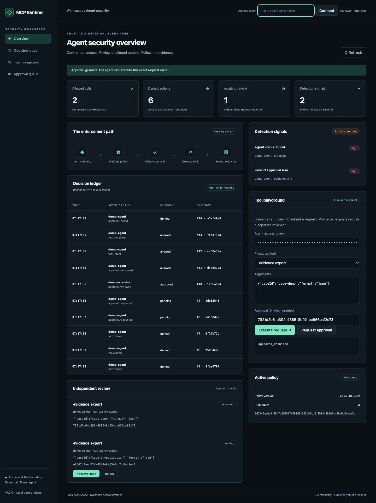
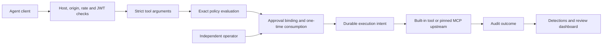

# MCP Sentinel

**A cloud-agnostic security boundary for MCP tool calls.**

Authenticate a registered agent, authorize its exact tool, validate arguments, require independent approval where configured, and record the decision before execution. Includes a real Streamable HTTP MCP endpoint, a REST API, a schema-pinned upstream MCP adapter, cloud-export summary tools, and an evidence dashboard.

[](https://github.com/jayekwere/mcp-sentinel/actions/workflows/verify.yml) [MIT](LICENSE)



## Try it

Requires Node 24 and npm, or Docker with Compose. All bundled examples use synthetic data and make no cloud API calls.

```sh
git clone https://github.com/jayekwere/mcp-sentinel.git
cd mcp-sentinel
npm ci --ignore-scripts
npm run verify
DEMO=1 npm start
```

Open **http://127.0.0.1:4310**. Startup prints disposable fifteen-minute tokens. Connect the **operator** token at the top of the page and place the **agent** token in the playground. Select `evidence.export`, request approval, approve that request in the review queue, and execute it. A second execution with the same approval is rejected. Use `admin.delete` to observe deny-by-default behavior.

```sh
docker compose up --build
# In another terminal, inspect the disposable tokens:
docker compose logs
# Stop the demo:
docker compose down
```

For a headless demonstration, `npm run demo` asserts denial, independent approval, successful execution, approval replay rejection, and detection signals. [Recorded output](evidence/demo.json) comes from that script. UUIDs and audit timestamps vary on each run.

```json
{
  "unapproved": { "status": 403, "error": "approval_required" },
  "review": "approved by independent operator",
  "approved": { "status": 200 },
  "replayed": { "status": 403, "error": "approval_required" },
  "audit": { "integrity": true, "entries": 12 }
}
```

The excerpt omits the returned synthetic evidence payload and signal list. The complete output is committed in the evidence directory.

## Enforced behavior

| Boundary      | Implemented behavior                                                                                                                                              |
| ------------- | ----------------------------------------------------------------------------------------------------------------------------------------------------------------- |
| Identity      | ES256/RS256 access-token verification, issuer, audience, expiry, maximum age, required claims, registered subject                                                 |
| Authorization | Exact tenant, agent, role, and tool matches; explicit deny wins; unmatched requests deny                                                                          |
| Input         | Strict tool argument schemas, bounded requests, no caller-selected endpoint or command                                                                            |
| Approval      | Independent same-tenant operator; five-minute expiry; binding to actor, tenant, agent, canonical arguments, tool schema, policy hash, and execution configuration |
| Concurrency   | Transactional one-time consumption before execution; consumed approvals remain consumed after errors or restart                                                   |
| Audit         | Durable intent and outcome events, request IDs, argument digests, policy fingerprints, authenticated hash chain                                                   |
| MCP           | Official SDK stateless Streamable HTTP; initialize, scoped tools/list, tools/call; REST and MCP share the same gateway                                            |
| Upstream      | Fixed HTTPS endpoint, dedicated credential, pinned name/description/input schema, no redirects, deadlines and response bounds                                     |
| Detection     | Five tool denials in sixty seconds, invalid approval use, and execution failures, with audit references                                                           |
| Browser       | Tenant-scoped ledger, approvals, signals, live playground, responsive layout, safe text rendering                                                                 |

The default policy grants the `researcher` agent in tenant `sandbox` access to two read tools and approval-gated evidence export. It grants no tools to operators or analysts. Operators review requests, and analysts inspect audit evidence. Configure a reviewed policy file with `POLICY_FILE` to change tool grants. Rules have no implicit wildcard syntax.

## Protected tools and cloud scope

- `knowledge.search`: searches a small local security reference catalog.
- `cloud.audit.summary`: validates bounded supplied AWS, Azure, or GCP audit-record projections and returns action counts and a digest. These are working export adapters, tested on synthetic fields from each provider. They do not retrieve cloud data, validate provider authenticity, or enforce cloud IAM.
- `evidence.export`: returns a complete synthetic case evidence payload and content digest. It creates no file and performs no cloud mutation. Its privileged classification demonstrates approval enforcement without a destructive demo.

The gateway runs independently of a cloud provider. Deployment on a particular cloud and access to that cloud's APIs still require operator infrastructure and integration work. No live cloud account, managed identity, or provider credential exchange was used in validation. For supported field shapes, see [the API guide](docs/API.md).

## Connect an MCP client

Connect an authenticated Streamable HTTP client to `http://127.0.0.1:4310/mcp`. Supply `Authorization: Bearer <agent token>`. GET streaming and DELETE session management return 405 because this service is stateless. The official SDK interoperability test initializes a client, lists scoped tools, executes a read, and verifies denied tool results over a real local HTTP connection.

After the REST approval workflow grants an approval, include it as custom request metadata:

```json
{
  "jsonrpc": "2.0",
  "id": 2,
  "method": "tools/call",
  "params": {
    "name": "evidence.export",
    "arguments": { "caseId": "case-demo", "format": "json" },
    "_meta": { "sentinel/approval": "<granted approval UUID>" }
  }
}
```

MCP tool failures return an `isError` tool result. REST failures use a non-success HTTP status and a stable error code. The approval ID is not an authentication credential.

## Validation and architecture



Run `npm test` for security, API, SDK interoperability, persistence, concurrency, and adapter tests. Run `npm run test:coverage` for a coverage report. Run `npm run test:browser` after `npx playwright install chromium`. Build the image with `docker build -t mcp-sentinel:local .`, then run `node scripts/container-smoke.mjs mcp-sentinel:local` to exercise authentication, approval, execution, and replay rejection inside the restricted container.

[Validation evidence](evidence/VALIDATION.md) records actual results. [Threat model](docs/THREAT-MODEL.md), [architecture](docs/ARCHITECTURE.md), [design decisions](docs/DESIGN-DECISIONS.md), [API](docs/API.md), [upstream configuration](docs/UPSTREAM.md), and [operations](docs/OPERATIONS.md) document the security and deployment contract.

## Limits

This is a single-node reference service with production-style controls, not a certified or independently audited production platform. Bearer-token theft still permits use until expiry. There is no proof of possession, automatic JWKS rotation, browser OAuth login, or immediate revocation service. Audit-chain suffix rollback needs an external checkpoint. Detection windows inspect at most the latest 1,000 tenant audit entries, so high-volume bursts can be undercounted. Rate limits are per process. There is no automatic retention or high availability.

The upstream adapter maps only the three declared local tools; it is not a transparent proxy for arbitrary MCP servers. Descriptor pins do not prove a server's runtime behavior. Output is untrusted data and is not scanned for every prompt-injection or exfiltration pattern. Pinned descriptions prevent unnoticed metadata drift, not malicious behavior behind unchanged metadata. Network egress policy belongs at the deployment boundary.

See [SECURITY.md](SECURITY.md) for reporting and [CONTRIBUTING.md](CONTRIBUTING.md) for changes. Licensed under [MIT](LICENSE).
